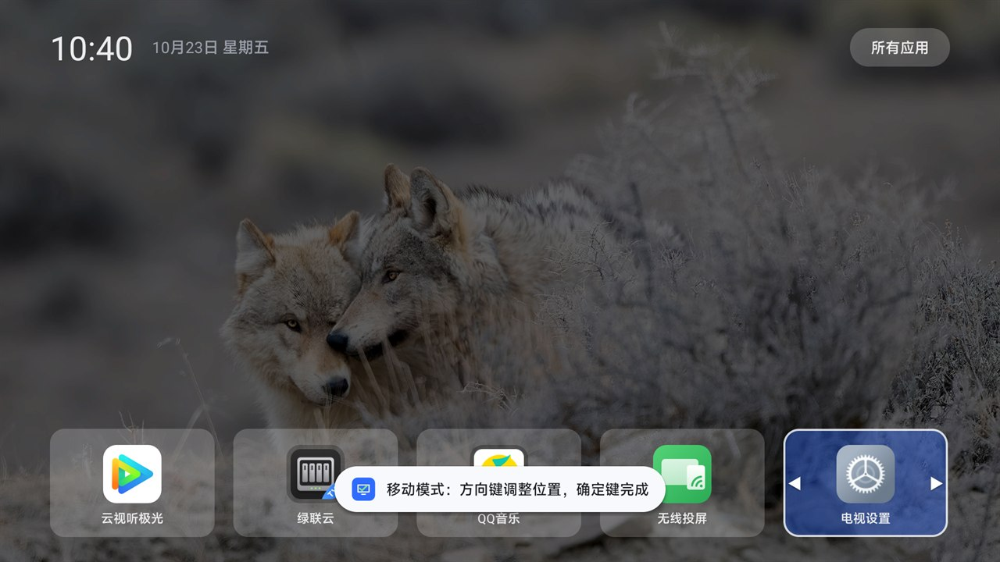
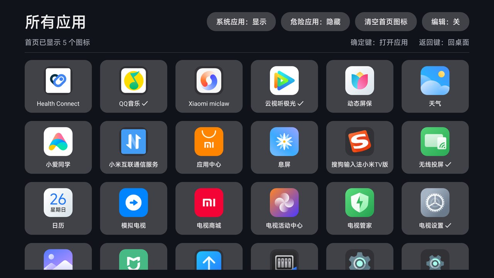
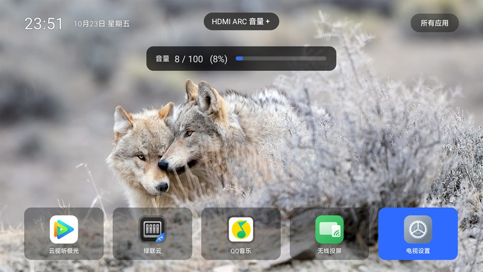

# CleanMyTV

**English** | [中文](README.md)

[](https://github.com/timothywei/CleanMyTV/actions/workflows/build.yml)
[](https://github.com/timothywei/CleanMyTV/releases)
[](LICENSE)

A minimal Android TV launcher built for the **Xiaomi TV (MiTV-MFFU0 / `finch`, HyperOS TV 4)**, made to replace the ad-laden PatchWall.

Zero third-party dependencies, built entirely from the command line, **40 KB APK**. The goal: **boot straight into a clean home screen with no promoted content.**

> ⚠️ **Read this first**: this approach requires enabling ADB, disabling the stock launcher (`com.mitv.tvhome`), and forcing a third-party app to become the Home app.
> That goes past the manufacturer's intended configuration. **Make sure you can accept "the TV might not reach a home screen and has to be recovered over ADB" before you start.**
> This project is for personal study and technical research; the author is not responsible for any device damage. The commands below were verified on MiTV-MFFU0 / HyperOS TV 4.0.11 and may not behave the same on your model.


---

## Download

**[⬇ CleanMyTV.apk](https://github.com/timothywei/CleanMyTV/releases/latest/download/CleanMyTV.apk)** · 40.7 KB · for MiTV-MFFU0 / HyperOS TV 4

[All releases and changelogs](https://github.com/timothywei/CleanMyTV/releases) · installation steps are in [Install](#install) below

> If you are new to ADB, read the whole [Install](#install) section before touching anything — getting the order wrong either fails to install, or installs but still lands in PatchWall.

---

## Why

PatchWall renders three promoted cards at the top of its "My Apps" page (a TV-series ad, an app-download prompt, and a trending list). What the investigation showed:

- Those cards are rendered by `com.mitv.tvhome` **itself**, not by an external ad app
- The data comes from `api.ptmi.gitv.tv/tv/lean/myappsnew/fl/in` on the server side and is **not governed by any local setting**
- Changing preferences, disabling ad packages, blocking DNS, switching to office mode — none of it worked

Conclusion: without replacing the launcher, they stay. So this project exists.

---

## Features

### Home screen

| Feature | Description |
|---|---|
| Clock / date | Live clock plus a localized date in the top-left corner |
| Bing daily wallpaper | Fetched once per day (silently retried on failure), with a 62% dark scrim |
| Bottom-anchored grid | The icon grid hugs the bottom edge, leaving the wallpaper visible above |
| Translucent cards | 20% white, letting the wallpaper texture through; solid blue when focused |
| Uniform icon treatment | Full-bleed icons are rounded and cropped; others get a shared plate and are centered |
| Smart initial focus | On cold start the focus lands on the **most frequently launched** app |
| Focus memory | Returning from an app restores the previous selection |

### Reordering (move mode)

```
Long-press OK / press MENU  →  enter move mode (white frame + ◀▶ arrows)
D-pad                      →  swap with the adjacent card
OK / BACK                  →  save and exit
```

The order is stored in SharedPreferences and survives reboots; newly installed apps are appended to the end.



### All apps

- 6-column grid listing every launchable app
- **System apps: hide/show** — system components are hidden by default
- **Dangerous apps: hide/show** — engineering components hidden by default (factory menu, TIF Test, VPN dialog, System UI, …)
- **Clear home icons** — wipe the home grid in one action
- **Edit: off/on** — in edit mode, OK toggles the selected app in or out of the home grid
- Live counter showing "N icons on the home screen"



### Volume HUD

- Pressing volume shows `Volume 22 / 100 (22%)` plus a progress bar centered at the top, auto-hidden after 2.5 s
- Implemented with a **foreground service + overlay window**, so it **works on top of any app**
- The number follows the current output device (speaker / HDMI / ARC)



### Other

- Left-push page transition animation (300 ms, with parallax)
- Custom vector app icon (blue plate, TV, green check mark)
- Wallpaper / network / decoding paths are wrapped in `catch (Throwable)`; any failure degrades silently and never takes the launcher down

---

## Technical notes

### 1. Making a third-party launcher become Home: Xiaomi's whitelist backdoor

Pointing `cmd package set-home-activity` at an ordinary package name **returns Success but has no effect** — Xiaomi's `MitvSettings.isThirdpartyHomeAllowed` rejects any Home app that is not on the whitelist.

The workaround: set the APK's **applicationId to `com.ts.launcher`** (a package name present in Xiaomi's cloud-controlled `third_party_home` whitelist), while keeping the Java package as `com.cleanmytv.home`:

```
applicationId : com.ts.launcher              ← whitelisted identity, must not change
Java package  : com.cleanmytv.home           ← code organization
component     : com.ts.launcher/com.cleanmytv.home.HomeActivity
```

Combined with `pm disable-user com.mitv.tvhome`, HOME resolves to this launcher and **survives reboots** (verified on OS4.0.11; the same model on OS3.0.115 used to fail, so OS4 actually opened this up).

### 2. Command-line-only build

No Gradle, no Android Studio — only the tools shipped with the SDK:

```
aapt2 compile → aapt2 link → javac → d8 → aapt add → zipalign → apksigner
```

### 3. Zero dependencies

Everything is based on the Android Framework API. No AndroidX, no Kotlin, no third-party libraries.

---

## Build

Requirements: **JDK 17**, the **Android SDK** (any installed `build-tools` and `platforms` — the script picks the newest) and the `ANDROID_HOME` environment variable.

The keystore password is passed via an environment variable rather than hard-coded:

```powershell
# 1. Set the keystore password (pick your own, and remember it)
$env:CMTV_KS_PASS = "your-keystore-password"

# 2. Build
cd launcher

# Plain-package build (for debugging; cannot become Home)
.\build.ps1 -Manifest AndroidManifest.xml -OutName CleanMyTV-debug.apk

# Whitelisted build (the one you actually use)
.\build.ps1 -Manifest AndroidManifest-ts.xml -OutName CleanMyTV.apk
```

Output: `launcher/CleanMyTV.apk`

If `launcher/debug.jks` does not exist yet, the script generates a fresh keystore using that password.

> 🔑 **The signing key is your app's identity.** If `debug.jks` is lost or replaced, newly built APKs **cannot be installed over** an existing installation — you must uninstall first,
> and uninstalling invalidates the Home setting, so you have to redo `set-home-activity`. Back up `debug.jks`, and never commit it.

---

## Install

```bash
# 1. Connect (enable ADB debugging on the TV first: Settings → Account & Security → ADB debugging)
adb connect <TV-IP>:5555

# 2. Install
adb install -r CleanMyTV.apk

# 3. Set as the default Home app (re-do this whenever the component name changes)
adb shell cmd package set-home-activity --user 0 com.ts.launcher/com.cleanmytv.home.HomeActivity

# 4. Disable the stock launcher
adb shell pm disable-user com.mitv.tvhome

# 5. Go home
adb shell input keyevent KEYCODE_HOME
```

### Overlay permission (for the global volume HUD)

```bash
adb shell appops set com.ts.launcher SYSTEM_ALERT_WINDOW allow
```

Without it, the HUD falls back to "home screen only" and does not crash.

### Transition animation (optional)

Some TVs ship with activity transitions disabled:

```bash
adb shell settings put global transition_animation_scale 1.0
```

---

## Usage

| Action | How |
|---|---|
| Open an app | D-pad to select → OK |
| Go to "All apps" | D-pad up to the top button → OK |
| Reorder icons | Long-press OK (or MENU) → D-pad to move → OK/BACK to save |
| Volume | Remote volume keys (the value is visible on any screen) |

---

## Repository layout

```
.
├── README.md / README.en.md
├── LICENSE                          MIT
├── .gitignore / .gitattributes
├── .github/                         issue templates, PR template, CI
├── docs/                            screenshots
└── launcher/
    ├── build.ps1                    build script (auto-detects build-tools)
    ├── AndroidManifest.xml          plain-package manifest
    ├── AndroidManifest-ts.xml       whitelisted manifest (com.ts.launcher)
    ├── res/
    │   ├── anim/                    4 transition animations
    │   └── drawable/ic_launcher.xml vector app icon
    ├── src/com/cleanmytv/home/
    │   ├── HomeActivity.java        home screen (clock/wallpaper/grid/move mode)
    │   ├── AllAppsActivity.java     all apps (filter/edit/clear)
    │   ├── IconFactory.java         uniform icon treatment (cached)
    │   ├── Wallpaper.java           Bing wallpaper loading (Bitmap cache)
    │   ├── BingWallpaper.java       daily wallpaper download (once per day)
    │   ├── VolumeHud.java           volume overlay (overlay / activity dual mode)
    │   ├── VolumeService.java       foreground service (keeps the volume listener alive)
    │   ├── BootReceiver.java        start on boot
    │   └── DbgLog.java              debug logging
    │
    ├── debug.jks                    signing key ★ generated locally, never committed
    ├── build/                       intermediate build output, never committed
    └── CleanMyTV.apk                artifact, never committed (download from Releases)
```

About 2,100 lines of Java, 40.7 KB APK.

---

## Known limitations

| Item | Notes |
|---|---|
| **ADB turns itself off on every reboot** | A Xiaomi TV behavior; you have to re-enable it on the TV before reconnecting |
| **CEC volume is not wired up** | With an external JBL Cinema 715 over ARC, the TV volume affects the soundbar, but the soundbar's own volume cannot be read or synchronized; third-party apps have no `HDMI_CEC` permission |
| **Overlay permission** | Must be granted manually, and again after a factory reset |
| **Signing key** | `debug.jks` must be kept, otherwise new APKs cannot be installed over the old one (uninstall + reinstall, which breaks the Home setting) |
| **A self-built APK ≠ the official APK** | An APK you build after forking is signed with your own key and **cannot be installed over** the official Releases APK; switching requires uninstalling first (which invalidates the Home setting, so the install steps must be repeated) |
| **The package name cannot change** | `com.ts.launcher` is what makes Home work; changing it drops you back to PatchWall |

---

## Rolling back to the stock launcher

```bash
adb shell pm enable com.mitv.tvhome
adb shell cmd package set-home-activity --user 0 com.mitv.tvhome/.MainActivityUserMode
adb shell input keyevent KEYCODE_HOME
```

---

## Disclaimer

This is a personal tool, provided "as is", without warranty of any kind, express or implied.

- Changing the default Home app and disabling system apps goes beyond supported configuration and **may leave the TV unable to reach a home screen**. Make sure you can recover over ADB (`pm enable com.mitv.tvhome` plus re-setting the Home app) before you begin.
- Verified only on **MiTV-MFFU0 / HyperOS TV 4.0.11**; behavior on other models and OS versions is untested.
- The author accepts no liability for device failure, data loss, or voided warranty resulting from use of this project.

---

## Credits

The approach and device notes draw on the public documentation of [CleanYourTV](https://github.com/Gathin23/cleanyourtv) (the Xiaomi whitelist mechanism, the `com.ts.launcher` backdoor, input switching, and more).

---

## License

[MIT](LICENSE) © 2026 timothywei

You are free to use, modify, and distribute this project, including commercially, as long as the copyright notice and license text are retained.
