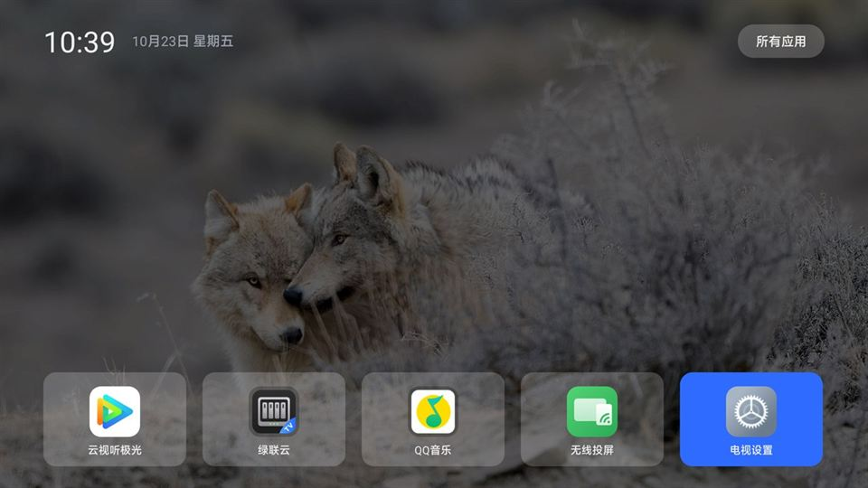

# CleanMyTV

一个为**小米电视（MiTV-MFFU0 / finch，HyperOS TV 4）**自研的极简桌面，用来替换广告缠身的 PatchWall。

纯命令行构建、零第三方依赖、APK 仅 40 KB。核心目标是：**开机即桌面，首页干净，没有推荐卡片。**

> ⚠️ **风险提示**：本方案需要开启 ADB、禁用系统桌面（`com.mitv.tvhome`）并把第三方应用设为 Home。
> 这已经越过了厂商的默认配置边界，**请先确认你能接受「电视可能进不去桌面、需要通过 ADB 恢复」的后果再动手**。
> 本项目仅供个人学习与技术研究，作者不对任何设备故障负责。文中命令已在本机（MiTV-MFFU0 / HyperOS TV 4.0.11）实测，不保证在你的机型上同样有效。



---

## 为什么做

小米电视的 PatchWall 桌面在「我的应用」页顶部固定渲染三个推广卡片（剧集广告、应用下载引导、热播榜）。实测排查下来：

- 这三个卡片由 `com.mitv.tvhome` **自己**渲染，不是外部广告 App
- 数据来自服务端 `api.ptmi.gitv.tv/tv/lean/myappsnew/fl/in`，**不受任何本地开关控制**
- 改设置项、禁广告包、断 DNS、切办公模式——全部无效

结论：不换桌面就去不掉。于是有了这个项目。

---

## 功能

### 首页

| 功能 | 说明 |
|---|---|
| 时间/日期 | 左上角实时时钟 + 中文日期 |
| Bing 每日壁纸 | 每天自动拉取一次（失败静默重试），带 62% 暗色遮罩 |
| 贴底图标网格 | 网格整体贴屏幕底部，中部大面积留白展示壁纸 |
| 半透明卡片 | 20% 白，透出壁纸纹理；聚焦时实色蓝高亮 |
| 图标统一化 | 满版图标圆角裁切，非满版图标套统一底板居中 |
| 智能初始焦点 | 冷启动落在**点击次数最多**的应用上 |
| 焦点记忆 | 从应用返回时保持上次选中位置 |

### 排序（移动模式）

```
长按确定键 / 按菜单键  →  进入移动模式（白框 + ◀▶ 箭头）
方向键                →  与相邻卡片交换位置
确定键 / 返回键        →  保存并退出
```

顺序存于 SharedPreferences，重启保留；新装应用追加到末尾。

### 所有应用

- 6 列网格，显示全部可启动应用
- **系统应用：隐藏/显示** —— 默认隐藏系统组件
- **危险应用：隐藏/显示** —— 默认隐藏工程组件（工厂菜单、TIF Test、VPN 对话框、系统 UI 等）
- **清空首页图标** —— 一键清空首页
- **编辑：关/开** —— 编辑模式下确定键 = 加入/移出首页
- 实时显示「首页已显示 N 个图标」

### 音量 HUD

- 调音量时顶部居中弹出 `音量 22 / 100 (22%)` + 进度条，2.5 秒自动隐藏
- 通过**前台服务 + 悬浮窗**实现，**在任意应用界面上都能显示**
- 数字跟随当前输出设备（扬声器 / HDMI / ARC）

### 其他

- 页面切换左推转场动画（300ms，带视差）
- 自定义矢量应用图标（蓝底 + 电视 + 绿色对勾）
- 壁纸/网络/解码全链路 `catch (Throwable)`，任何失败都静默降级，不影响桌面

---

## 技术要点

### 1. 让第三方桌面成为 Home：小米白名单后门

直接 `cmd package set-home-activity` 指向普通包名会**返回 Success 但无效**——小米框架的 `MitvSettings.isThirdpartyHomeAllowed` 会拦截非白名单的 Home。

解法：把 APK 的 **applicationId 改成 `com.ts.launcher`**（小米云控 `third_party_home` 白名单里的包名），Java 包名仍保持 `com.cleanmytv.home`：

```
applicationId : com.ts.launcher              ← 白名单身份，不能改
Java 包名      : com.cleanmytv.home           ← 代码组织
组件           : com.ts.launcher/com.cleanmytv.home.HomeActivity
```

配合 `pm disable-user com.mitv.tvhome`，HOME 即可解析到本桌面，且**重启后保持**（本机型 OS4.0.11 实测通过；同型号 OS3.0.115 曾经失败，OS4 反而放开了）。

### 2. 纯命令行构建

不依赖 Gradle / Android Studio，只用 SDK 自带工具：

```
aapt2 compile → aapt2 link → javac → d8 → aapt add → zipalign → apksigner
```

### 3. 零点依赖

全部基于 Android Framework API，没有 AndroidX / Kotlin / 任何第三方库。

---

## 构建

需要：**JDK 17**、**Android SDK**（已安装任意版本的 `build-tools` 与 `platforms`，脚本会自动选取最新版），并设置环境变量 `ANDROID_HOME`。

签名口令通过环境变量传入，不写在脚本里：

```powershell
# 1. 设置签名口令（自己定一个，务必记住）
$env:CMTV_KS_PASS = "你的密钥库口令"

# 2. 构建
cd launcher

# 普通包名版（调试用，无法成为 Home）
.\build.ps1 -Manifest AndroidManifest.xml -OutName CleanMyTV-debug.apk

# 白名单版（正式使用）
.\build.ps1 -Manifest AndroidManifest-ts.xml -OutName CleanMyTV.apk
```

产物：`launcher/CleanMyTV.apk`

首次构建时若 `launcher/debug.jks` 不存在，脚本会用该口令自动生成一个新的密钥库。

> 🔑 **签名密钥是唯一身份**：`debug.jks` 一旦丢失或更换，新构建的 APK **无法覆盖安装**已装版本，只能先卸载——
> 而卸载会让 Home 设置失效，需要重新走一遍 `set-home-activity`。请务必备份 `debug.jks`，且不要提交到公开仓库。

---

## 安装

```bash
# 1. 连接（电视需先开启 ADB 调试：设置 → 账号与安全 → ADB 调试）
adb connect <电视IP>:5555

# 2. 安装
adb install -r CleanMyTV.apk

# 3. 设为默认 Home（组件名变了就要重设，尤其是改名/改包名之后）
adb shell cmd package set-home-activity --user 0 com.ts.launcher/com.cleanmytv.home.HomeActivity

# 4. 禁用原桌面
adb shell pm disable-user com.mitv.tvhome

# 5. 回到桌面
adb shell input keyevent KEYCODE_HOME
```

### 悬浮窗权限（音量 HUD 全局显示）

```bash
adb shell appops set com.ts.launcher SYSTEM_ALERT_WINDOW allow
```

未授权时会自动回退为「只在桌面显示」，不会崩溃。

### 转场动画（可选）

部分电视出厂关闭了 Activity 转场：

```bash
adb shell settings put global transition_animation_scale 1.0
```

---

## 使用

| 场景 | 操作 |
|---|---|
| 打开应用 | 方向键选中 → 确定键 |
| 进「所有应用」 | 方向键向上到顶部按钮 → 确定 |
| 排序图标 | 长按确定键（或按菜单键）→ 方向键移动 → 确定/返回保存 |
| 音量 | 遥控器音量键（任何界面都能看到数值） |

---

## 文件结构

```
.
├── README.md
├── LICENSE                          MIT
├── .gitignore / .gitattributes
├── docs/
│   └── home.jpg                     首页效果图
└── launcher/
    ├── build.ps1                    构建脚本（自动探测 build-tools）
    ├── AndroidManifest.xml          普通包名版
    ├── AndroidManifest-ts.xml       白名单版（com.ts.launcher）
    ├── res/
    │   ├── anim/                    转场动画（4 个）
    │   └── drawable/ic_launcher.xml 矢量应用图标
    ├── src/com/cleanmytv/home/
    │   ├── HomeActivity.java        首页（时钟/壁纸/网格/移动模式）
    │   ├── AllAppsActivity.java     所有应用（过滤/编辑/清空）
    │   ├── IconFactory.java         图标统一化（带缓存）
    │   ├── Wallpaper.java           Bing 壁纸加载（带 Bitmap 缓存）
    │   ├── BingWallpaper.java       每日壁纸下载（每天限一次）
    │   ├── VolumeHud.java           音量浮层（悬浮窗 / Activity 双模式）
    │   ├── VolumeService.java       前台服务（保活音量监听）
    │   ├── BootReceiver.java        开机自启（拉起音量服务）
    │   └── DbgLog.java              调试日志
    │
    ├── debug.jks                    签名密钥 ★ 本地生成，不入库
    ├── build/                       构建中间产物，不入库
    └── CleanMyTV.apk                成品，不入库（请从 Releases 下载）
```

约 2100 行 Java，APK 40.7 KB。

---

## 已知限制

| 项 | 说明 |
|---|---|
| **ADB 每次重启都关闭** | 小米电视的行为，重连前需在电视上重新打开 |
| **CEC 音量未打通** | 外接 JBL Cinema 715（ARC）时，电视音量对音响有效，但无法读取/同步音响自身音量；第三方 App 无 `HDMI_CEC` 权限 |
| **悬浮窗权限** | 需要手动授权，恢复出厂后需重设 |
| **签名密钥** | `debug.jks` 必须保留，否则新 APK 无法覆盖安装（只能卸载重装，会导致 Home 失效） |
| **自行构建 ≠ 官方 APK** | 你 fork 后构建的 APK 用你自己的密钥签名，与 Releases 里的官方 APK 签名不同，**无法互相覆盖安装**，切换时需先卸载（Home 设置随之失效，需重跑一遍安装步骤） |
| **包名不能改** | `com.ts.launcher` 是 Home 生效的关键，改了会退回 PatchWall |

---

## 回滚到原桌面

```bash
adb shell pm enable com.mitv.tvhome
adb shell cmd package set-home-activity --user 0 com.mitv.tvhome/.MainActivityUserMode
adb shell input keyevent KEYCODE_HOME
```

---

## 免责声明

本项目为个人自用工具，按「现状」提供，不附带任何明示或暗示的担保。

- 修改默认 Home、禁用系统应用属于越界操作，**可能导致电视无法正常进入桌面**，请确保你能通过 ADB 恢复（`pm enable com.mitv.tvhome` + 重设 Home）后再操作。
- 项目仅在 **MiTV-MFFU0 / HyperOS TV 4.0.11** 上验证，其他机型/系统版本的行为未经测试。
- 因使用本项目导致的设备故障、数据丢失或保修失效，作者不承担责任。

---

## 参考

项目思路与机型资料参考了 [CleanYourTV](https://github.com/Gathin23/cleanyourtv) 的公开文档（小米白名单机制、`com.ts.launcher` 后门、输入源切换等）。

---

## 许可证

[MIT](LICENSE) © 2026 timothywei

你可以自由使用、修改、分发本项目，包括商业用途，只需保留版权声明与许可证文本。
